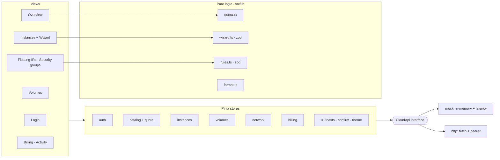

<!-- topics: vue,vue3,typescript,pinia,tailwindcss,openstack,cloud-console,dashboard,vite -->
# Vue Cloud Console

Customer-facing cloud console in Vue 3 + TypeScript: compute, block storage, floating IPs, security groups, billing and an activity log, modelled on an OpenStack tenant portal and runnable with zero backend through a mock API layer.

[](https://github.com/AkibUllah/vue-cloud-console/actions/workflows/ci.yml)


## Try it live

| | |
|---|---|
| Live demo | https://akibullah.github.io/vue-cloud-console/ — the real console on the in-memory mock API; sign in with any email and a password of six or more characters (prefix the email with `admin` for the admin role) |
| Run in your browser | [](https://codespaces.new/AkibUllah/vue-cloud-console?quickstart=1) — installs dependencies and starts the Vite dev server in mock mode; open the forwarded port 5173 ("Cloud Console") |
| One-click deploy | [](https://render.com/deploy?repo=https://github.com/AkibUllah/vue-cloud-console) — nginx image from the Dockerfile in mock mode |
| Local | `docker compose up --build -d` or `npm install && npm run dev` (see Quick Start) |

## Why this exists

Horizon, the stock OpenStack dashboard, is built for operators. Customers of a local cloud want something narrower and friendlier: launch a VM in five guided steps, see how much of their quota is left before they hit a 403, attach a volume without reading the Cinder docs, and understand the bill in taka. This console is that product surface. The API layer is an interface with two implementations, so the UI can be developed and tested entirely against an in-memory mock with realistic latency and state transitions, then pointed at a real gateway by flipping one environment variable.

## Features

- Login with session restore and route guards (`next` redirect after sign-in)
- Overview: six SVG quota gauges with warning/critical thresholds, month-to-date and projected spend, daily spend chart, recent activity
- Instances: filterable table, start / stop / reboot / delete with confirmation, live polling while any instance is in BUILD / REBOOT / DELETING
- Launch wizard: image → flavor → network + security groups → key pair → review, zod-validated per step, image/flavor compatibility filtering, quota pre-check and hourly/monthly cost estimate
- Volumes: create with quota check, attach / detach to instances, delete
- Floating IPs: allocate, associate, disassociate, release
- Security groups: create, delete (default protected), rules table editor with CIDR/port/protocol validation and duplicate detection
- Billing: usage lines, category breakdown, projection, invoices; activity log with filter
- Mock API (`src/api/mock`) with latency, in-memory state, quota enforcement and an activity trail; HTTP client (`src/api/http`) sharing the same interface
- Toasts, confirm dialog, dark mode, responsive sidebar

## Architecture



Key decisions:

- **One interface, two clients.** Every store talks to `CloudApi`; `createApiFromEnv()` picks the mock or the HTTP client from `VITE_API_MODE`. Tests inject the zero-latency mock with `setApi()`.
- **Business rules live outside components.** Quota math, wizard step validation, cost estimate and security-rule validation are pure TypeScript modules, so they are unit-tested without mounting anything.
- **Stores own side effects and feedback.** Actions call the API, update local state optimistically from the response, and raise toasts; destructive actions go through a promise-based `ui.ask()` confirm dialog.
- **The mock behaves like the real thing.** It enforces quota, rejects invalid transitions (stop a stopped VM, release an associated IP, delete the default group) and walks BUILD → ACTIVE over time, so the UI handles the same edge cases it will meet in production.
- **No chart library.** The gauges and the spend chart are small SVG components; the whole app is ~160 KB gzipped.

## Tech Stack

| Layer | Choice |
|---|---|
| Framework | Vue 3.4 (Composition API, `<script setup>`), TypeScript 5.4, Vite 5 |
| State / routing | Pinia 2 (setup stores), Vue Router 4 |
| Validation | zod 3 |
| Styling | Tailwind 3.4, class-based dark mode |
| Tests | vitest 1 + @vue/test-utils 2 |
| Quality | ESLint (vue3-recommended + typescript), vue-tsc type-check in `build` |
| Ops | Dockerfile (nginx static), docker compose, GitHub Actions Node 18/20 |

## Quick Start

Docker Compose (mock mode, http://localhost:8080):

```bash
docker compose up --build -d
open http://localhost:8080
```

Local:

```bash
cp .env.example .env
npm install
npm run dev            # http://localhost:5173
```

Sign in with any email and a password of six or more characters. Prefix the email with `admin` for the admin role. Set `VITE_API_MODE=http` and `VITE_API_BASE` to use the HTTP client against a gateway that implements the endpoints in `src/api/http/index.ts`.

## Usage

The API contract the UI depends on, in `src/api/index.ts`:

```ts
export interface CloudApi {
  login(email: string, password: string): Promise<Session>;
  catalog(): Promise<{ images; flavors; networks; keypairs }>;
  quota(): Promise<Quota>;
  listInstances(): Promise<Instance[]>;
  createInstance(input: CreateInstanceInput): Promise<Instance>;
  instanceAction(id: string, action: 'start' | 'stop' | 'reboot'): Promise<Instance>;
  // volumes, floating IPs, security groups, billing, activity …
}
```

Reusing the pure logic elsewhere:

```ts
import { canLaunch, quotaViews } from '@/lib/quota';
import { estimate, validateStep } from '@/lib/wizard';

canLaunch(quota, flavor, 2);   // { ok: false, blockers: ['vCPUs: need 8, 4 left'] }
estimate(flavor);              // { hourly_bdt: 7, monthly_bdt: 5208 }
validateStep(wizardState);     // { name: 'at least 3 characters' }
```

## Project Structure

```
vue-cloud-console/
├── src/
│   ├── api/
│   │   ├── index.ts        # CloudApi interface, ApiError, createApiFromEnv
│   │   ├── types.ts
│   │   ├── client.ts       # shared instance + setApi() for tests
│   │   ├── mock/           # in-memory implementation + seed data
│   │   └── http/           # fetch implementation (same interface)
│   ├── stores/             # auth, catalog, instances, volumes, network, billing, ui
│   ├── lib/                # quota, wizard, rules, format (pure, unit-tested)
│   ├── components/         # AppShell, QuotaGauge, SpendChart, StatusBadge, ToastList, ConfirmDialog
│   ├── views/              # Login, Overview, Instances, InstanceWizard, Volumes, FloatingIps, SecurityGroups, Billing, Activity
│   └── router/
├── Dockerfile · nginx.conf · docker-compose.yml
└── .github/workflows/ci.yml
```

## Testing

```bash
npm test          # 26 tests
npm run lint
npm run build     # vue-tsc --noEmit + vite build
```

Covered: quota percentages/levels/launch checks, wizard step validation and gating, flavor compatibility, cost estimate, review problems; security rule parsing and validation; auth, instances (create, transitions, confirm-gated delete, quota rejection), volumes (create/attach/detach/delete), network (floating IP lifecycle, rule add/duplicate/remove, default group protection), billing math and store; QuotaGauge, SpendChart, StatusBadge, toasts and confirm dialog.

## Roadmap

- Instance detail page with console log and resize
- Snapshots and images management
- Keypair creation (upload public key) and project member management
- Keystone-compatible auth in the HTTP client (scoped tokens, catalog discovery)
- Bangla locale for labels and BDT numerals

## License

MIT © 2026 Akib Jafor
